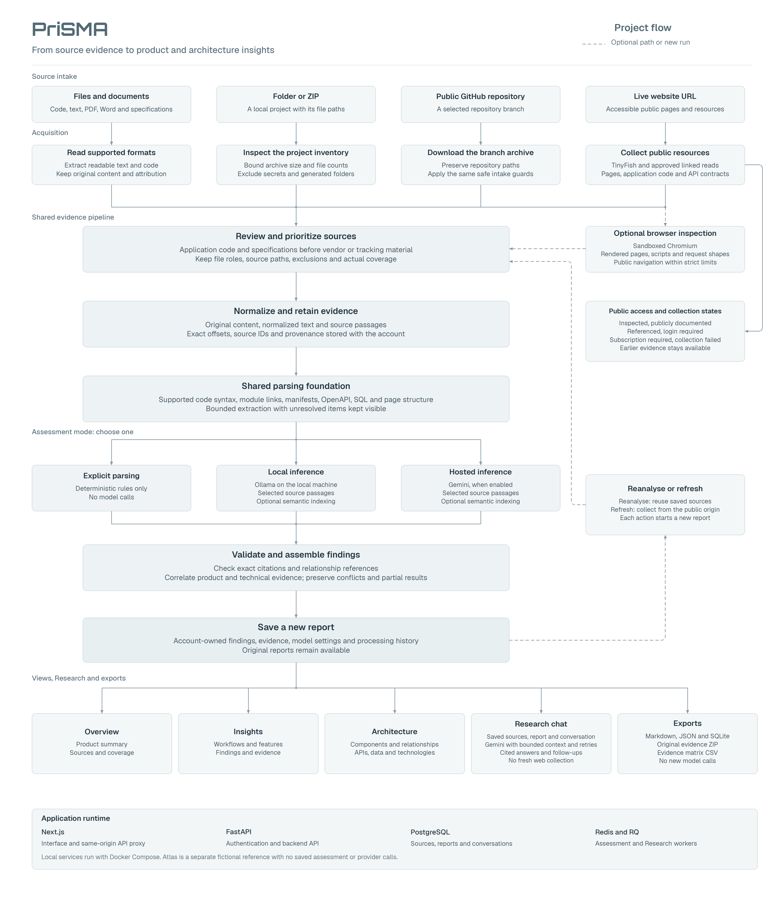

# PriSMA

PriSMA helps people understand unfamiliar software. It collects evidence from files, project folders, public GitHub repositories and live websites, then presents the product's features, technologies and possible architecture in one workspace.

We built it to make technical research easier for students, developers and teams. Each finding stays connected to its source, so users can check how we reached it.

### DEPLOYMENT

**ITS LIVE** (FOR A LIMITED TIME ONLY). GIVE IT A TRY:  [`prisma.live`](https://pri-sma.vercel.app)

> **NOTE:** To keep this demo strictly within zero-cost free-tier resource bounds, the **Browser Inspection** feature is disabled in the live deployment. Browser inspection requires PriSMA's isolated, sandboxed **Chromium** container (`--profile browser`), which runs with dedicated Linux seccomp security profiles and higher memory bounds. The full browser inspection pipeline can be experienced locally via the running commands mentioned in "STOP-START SIMPLE" section.

## DEMONSTRATION
https://github.com/user-attachments/assets/6c1969d6-4c65-42c5-9e54-3241ac5b177d


## WHAT IT DOES

- Accepts documents, source files, folders, ZIP archives, public GitHub repositories and public website URLs.
- Builds an overview of the product, its workflows and the evidence collected.
- Maps components, relationships, API routes, data structures and technologies where the sources support them.
- Separates inspected evidence from references, access restrictions and collection failures.
- Supports follow-up questions through Research chat, using the saved report and sources.
- Saves reports and exports Markdown, JSON, SQLite, evidence ZIPs and an evidence matrix CSV.

## WORKING

1. **Collect:** choose an input and review the available sources. Website collection can also use optional browser inspection.
2. **Read:** classify the files and keep their paths, text and source details. Imported projects are inspected without running their code.
3. **Analyze:** use explicit parsing, or add optional local or hosted model analysis.
4. **Explain:** view the findings in Overview, Insights and Architecture, with supporting evidence.
5. **Research:** ask questions about the saved report and export the results.

> NOTE: Public website analysis only uses accessible evidence. It cannot reveal a complete private backend or inspect content behind a login or subscription. Missing evidence and failed collection remain visible in the report.

## TECH STACK

<p align="center">
  <!-- Interface -->
  
  
  
  <!-- API & Analysis -->
  
  
  <!-- Storage & Jobs -->
  
  
  
  <!-- AI & Tools -->
  
  
  
  
</p>

---

## TINYFISH INTEGRATION

**PriSMA** uses **TinyFish** to help discover and collect relevant public information from these pages. This gives the analysis more context about what the product does and how its publicly described systems connect.

The integration supports two parts of collection:

- **Discovery:** find relevant pages when the supplied URL does not provide enough useful information. (Tiny Search)
- **Collection:** retrieve selected pages and retain their content, source URLs and collection outcomes as evidence. (Tiny Fetch)

The collected material enters the same analysis pipeline used for uploaded files and repositories. PriSMA prioritizes useful application evidence, applies request limits and reuses cached responses where appropriate.

TinyFish supports public information gathering. It does not provide access to private source code or bypass login and subscription restrictions. Optional Chromium inspection separately adds evidence from rendered pages, loaded scripts and observed requests.

The integration is disabled by default. To enable it, set `TINYFISH_ENABLED=true` and add `TINYFISH_API_KEY` to the root `.env`.

## ARCHITECTURE



---

## RUNNING LOCALLY

Requirement: Git, Python3, Docker with COmpose v2. (On Windows, use a WSL terminal with Docker integration enabled.)

Run all commands from the repository root, where `compose.yaml` is located.

### 1. Clone the repository

### 2. Create your .env

```bash
bash scripts/setup-env.sh
```
(This creates a root `.env` from `.env.example` and generates a PostgreSQL password. An existing `.env` is kept unchanged. Run the setup script as your normal user.)

### 3. Start PriSMA

```bash
sudo docker compose config --quiet
sudo docker compose up --build -d
sudo docker compose ps
```

Open [localhost:3000](http://localhost:3000) and create an account. Explicit parsing works without API keys. 

> You can also explore the fictional Atlas reference at [localhost:3000/reference](http://localhost:3000/reference).

### 4. OPTIONAL FEATURES

Edit the existing entries in `.env`, or add an entry if it is missing. Configure only the features you plan to use.

| Feature | Required setup |
| --- | --- |
| Research chat | Set `GEMINI_API_KEY` and keep `ALLOW_HOSTED_QUERIES=true`. |
| Live URL collection | Set `TINYFISH_API_KEY` and `TINYFISH_ENABLED=true`. |
| Hosted assessment analysis | Set `GEMINI_API_KEY` and `ALLOW_HOSTED_MODELS=true`. |
| Browser inspection | Start the `browser` profile, then enable browser inspection for the URL assessment. Live URL collection still needs TinyFish configuration. |
| Local model analysis | Start the `inference` profile and download the models below. |

To run the application with both browser inspection and the local model service:

```bash
sudo docker compose --profile inference --profile browser up --build -d
sudo docker compose --profile inference --profile browser ps
```

You can use just `--profile browser` or `--profile inference` if you only need one. Before choosing local inference, download the models once:

```bash
sudo docker compose --profile inference exec -T ollama ollama pull qwen3:1.7b
sudo docker compose --profile inference exec -T ollama ollama pull all-minilm
```

> Model downloads need an internet connection and use disk space. Hosted features send the selected evidence to their configured provider. Provider availability and account quotas still apply.

After editing API keys or other backend settings, apply them with:

```bash
sudo docker compose up -d --force-recreate api worker research
```

## STOP-START SIMPLE:

For a complete shutdown, include both optional profiles, even if you only started one:
```bash
sudo docker compose --profile inference --profile browser down --remove-orphans
```

> This removes the project's containers and network, including optional services and old project containers. Named volumes keep your accounts, reports, evidence and downloaded models. Do not add `-v` unless you intend to delete that data.

THEN:
```bash
sudo docker compose --profile inference --profile browser up -d
```

## REBUILDING AFTER ANY CHANGE: 

```bash
sudo docker compose --profile inference --profile browser up --build -d
```

Or rebuild only affected services:
```bash
# Frontend code or files added to frontend/public/
sudo docker compose up --build -d frontend

# Backend code
sudo docker compose up --build -d api worker research

# Browser service code
sudo docker compose --profile browser up --build -d browser
```

## Check service status and recent logs:

```bash
sudo docker compose --profile inference --profile browser ps -a
sudo docker compose --profile inference --profile browser logs --tail=100 api worker research browser
```
If shutdown reports that the network is still in use, run the complete shutdown command above from this repository root. If it still fails, inspect the containers attached to the network:

```bash
sudo docker network inspect prisma_default --format '{{range .Containers}}{{println .Name}}{{end}}'
```

## Future Scope

We plan to improve PriSMA in the following areas:

1. **Deeper language support:** extend syntax analysis and improve how imports, calls and declarations are connected across larger projects.
2. **Better workflow discovery:** inspect more public routes and interface states through controlled browser navigation, while keeping interactions bounded and read-only.
3. **Authorized private sources:** support private repositories and authenticated resources through explicit permissions, with clear credential handling and access boundaries.
4. **Change tracking:** compare successive assessments and explain changes in architecture, dependencies, APIs and product features.
5. **Stronger evidence validation:** improve checks for unsupported conclusions, conflicting sources and uncertain relationships, supported by a broader evaluation dataset.
6. **More efficient analysis:** improve source selection, incremental processing and caching so larger projects require less repeated work and fewer provider requests.
7. **Team collaboration:** add shared workspaces, report annotations and review tools so teams can investigate and discuss findings together.
8. **Clearer research and reports:** improve follow-up answers, coverage explanations and presentation-ready exports for technical reviews and product research.

---

## LICENSE
This project is built under [GPL v3.0 LICENSE](LICENSE).
